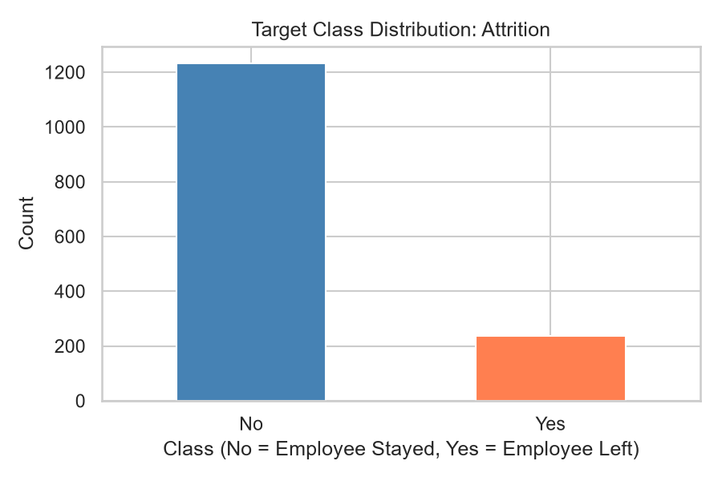
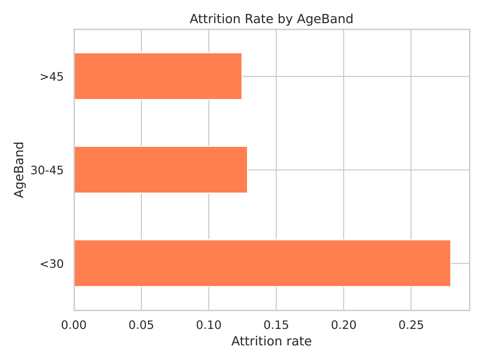
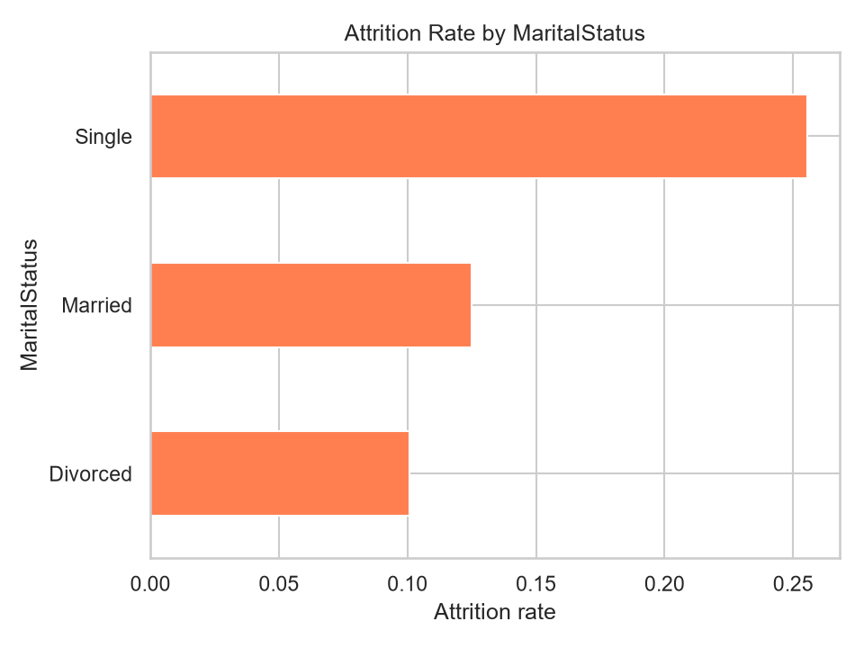

# HR Problem Framing

## Prediction Task

The model estimates the probability that a current employee will leave the organisation, this is based on their demographic, role, pay and other workplace attributes and conditions. This is a binary classification problem and the target variable is 'Attrition' which is either Yes or No. The classes are imbalanced with around 16% of the 1,470 employees in the dataset having left the company, so a model that always predicts "No" would be right 84% of the time - which wouldn't be useful to HR staff trying to better position retention conversations with high flight risk employees.

The output is a risk score (0-1) which is then converted into "High", "Medium" or "Low" bands using a threshold chosen against the cost of errors (see Definition of Success). The score may bring insight into a decision, which HR staff should then decide whether a retention conversation may be constructive to preventing attrition, it doesn't make automated decisions about employees.

It's worth noting that the model only learns associations, not causes, a link for example between 'YearsSinceLastPromotion' and 'Attrition' doesn't necessarily mean promoting someone would retain them.

## Likely Users of the Prediction

|        Stakeholder          |     Role     |               Needs             |                          Risks                       |
|-----------------------------|--------------|---------------------------------|------------------------------------------------------|
| HR business partners        | Direct user  | Ranked list                     | Over-reliance on scores/Automation bias              |
| Line managers               | Direct user  | Insight about teams             | Unconsciously treating flagged employees differently |
| Current employees           | Affected     | Fair treatment and transparency | Stigma and potential missed opportunities            |
| Data Protection Officer     | Oversight    | Lawful basis                    | Regulatory and reputational damage                   |
| ML/Data team                | Maintenance  | Monitoring                      | Model degradation                                    |
| Executives                  | Indirect     | Lower attrition                 | Poor investment decisions from model output          |
| Employee representatives    | Indirect     | Assurance about tool use        | Erosion of trust between employees and employer      |

**Scope boundary:** the model must not be used when screening for recruitment, redundancy selection, performance management or pay related decisions. Potential employees and future employees are outwith the scope and thus must never be scored.

## Potential Failure Modes

False Negative: A high value employee leaves and was missed
A senior engineer with high levels of overtime and hadn't been promoted in 4 years was scored as a low-risk, no retention conversation was planned between the employee and manager and they then resign. The organisation then has to go find an employee of a similar calibre and suffers replacement costs as well as brain drain while the team takes on the extra workload due to their resignation. It's worth noting that the model cannot guarantee the retention conversation would have prevented attrition.

False positive: A loyal employee is flagged as a flight risk
A recently married employee in their late 20s is flagged as high risk. Their manager then sees the risk and instead of having a retention conversation, gives a development opportunity to a colleague instead of them who's low risk. The employee is essentially punished without ever knowing why and the lost opportunity may even make them leave. The harm falls on the employee, not the organisation, this makes this a serious ethical failure.

Biased errors: False positives are concentrated in one group
'Age' and 'MaritalStatus' correlate with 'Attrition', and because 'TotalWorkingYears' and 'JobLevel' are proxy variables for 'Age', the model may flag young or single employees at a higher rate than others with similar circumstances. This creates a risk of violating the Equality Act 2010, even if the protected attributes are removed from the inputs.

Misuse and automation bias
Scores are repurposed by managers and HR staff, for example, to shortlist people for redundancy, or managers accept the scores without ever applying their own judgement. A tool meant to support decisions and provide insight has morphed into an unaccountable decision-maker as if it were human, breaking UK GDPR rules on automated decision-making.

## Definition of Success

All targets are provisional and can be revisited once baselines become available. Any changes will be justified, not adjusted to suit results.

### Predictive performance

PR-AUC is the main metric as it reflects the performance on the minority (Leavers) class and isn't affected by the 84% majority as much as others. A recall of 0.70 or greater on Leavers with a precision of 0.40 or greater is considered as acceptable since this translates into at most 3 out of 5 flags would be false alarms, which is considered acceptable as retention conversations are low-cost and voluntary. The final model has to beat both a majority class dummy baseline as well as a logistic regresssion baseline on witheld test data.

### Fairness

The difference in recall and false positive rate between genders and between age bands (<30, 30-45, >45) should be less than or equal to 0.10. Equalised odds style measures have been chosen over demographic parity, since base attrition rates can actually differ between groups. Unequal error rates is a concern as opposed to unequal flag rates.

### Reliability and reproducibility

The standard deviation of PR-AUC across 5 fold stratified cross validation is less than or equal to 0.05 and predicted probabilities are reasonably calibrated (Checked against calibrationc curve). The results are fully reproducible (Fixed seeds, pinned dependencies, versioned code and data) and has an automated test suite that passes in CI.

### Governance and human oversight

Every flag has to be reviewed by a human, no automated actions are taken from the score. A model card and a DPIA will be completed before any deployment. Permitted as well as prohibited uses are documented and performance, drift and fairnesss are monitored and any retraining or model promotion will require recorded approval. Each prediction is accompanied with an explanation (For example SHAP top factors) that HR can understand.

